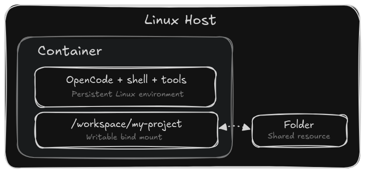

# OpenCave

A rootless Podman container for [OpenCode](https://opencode.ai). Host file access is scoped to the mounted folder only. Optional [OpenChamber](https://openchamber.dev) web UI.

## Overview



**Motivation:** ask your host agent whether it can read your browser's passwords, history, SSH keys, or anything — and see...

## Prerequisites

```sh
# Fedora / RHEL
sudo dnf install podman curl util-linux tar
# Ubuntu / Debian
sudo apt install podman uidmap curl util-linux tar
```

## Install

```sh
curl -fL --progress-bar https://raw.githubusercontent.com/ernvk23/opencave/main/bootstrap.sh | bash
```

Or run `./setup.sh` from a checkout.

## Usage

```sh
opencave [DIR]                   # OpenCode in a project
opencave shell                   # Open a shell
opencave serve [DIR]             # Start OpenCode web UI
opencave serve [DIR] --openchamber # Add the OpenChamber UI
opencave import-skills [DIR]     # Import host skills
opencave help                    # List commands

opencave update                  # Update OpenCode and OpenChamber
opencave update --system         # Also upgrade Alpine packages in OpenCave
opencave reset                   # Clear chats and packages, keep provider logins
```

More commands: `opencave help`.

## Uninstall

```sh
opencave uninstall
```

Removes its containers, images, CLI, and local data. Mounted project folders are never touched.

[MIT license](LICENSE)
